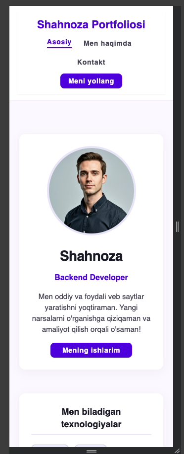
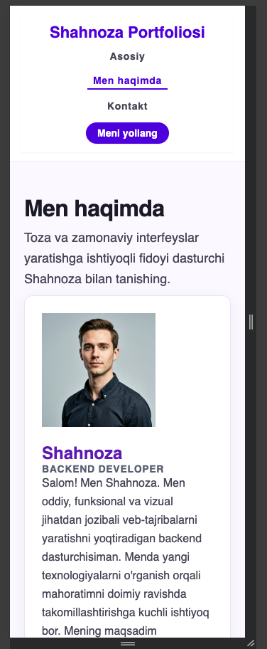
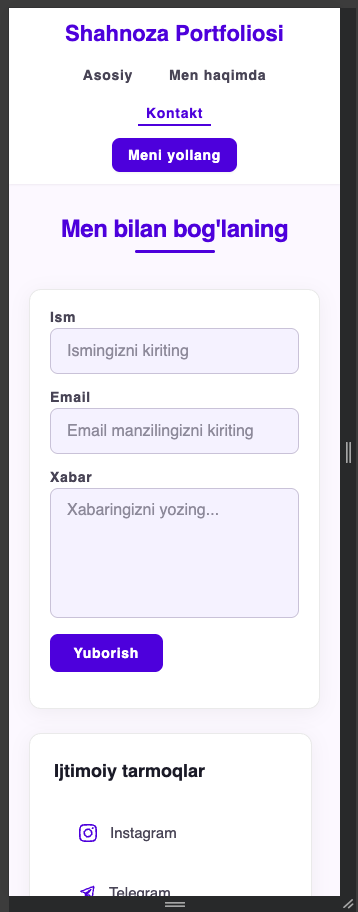

# 🌐 Shahnoza Portfolio

Backend Developer shaxsiy portfolio veb-sayti. Ushbu loyiha zamonaviy va sodda dizayn asosida yaratilgan bo'lib, ishlab chiquvchi haqida ma'lumotlar, biladigan texnologiyalari hamda interaktiv funksiyalarni o'z ichiga oladi.

## 🚀 Texnologiyalar (Tech Stack)

- **HTML5** — Veb-sahifalarning strukturasi
- **CSS3** — Figma maketiga mos ravishda tayyorlangan vizual stillar
- **JavaScript** — Interaktiv interfeys (Counter funksionalligi)
- **Git & GitHub** — Versiyalarni boshqarish va kodlarni saqlash

---
# 🚀 My Portfolio Website

Bu mening shaxsiy portfolio loyiham bo'lib, zamonaviy veb-dizayn standartlari va **Mobile-First** yondashuvi asosida qurilgan. Loyihada foydalanuvchi interfeysi, sahifalararo o'tishlar va kichik interaktiv funksiyalar mavjud.

---

## 📁 Loyiha Strukturasi

Loyihaning fayl va papkalar tuzilishi quyidagicha ko'rinishga ega:

```text
MY-PORTFOLIO/
│
├── images/                  # Skrinshotlar va grafik resurslar
│   ├── asosiy.png           # Asosiy sahifa ko'rinishi
│   ├── about.png            # Men haqimda sahifasi
│   └── kontakt.png          # Kontakt sahifasi
│
├── node_modules/            # Bog'liqliklar papkasi
├── about.css                # "Men haqimda" sahifasi uslublari
├── about.html               # "Men haqimda" sahifasi
├── contact.css              # Kontakt sahifasi uslublari
├── contact.html             # Kontakt sahifasi
├── index.html               # Asosiy sahifa
├── style.css                # Asosiy uslublar fayli
├── script.js                # Interaktiv funksiyalar va JavaScript skripti
├── package.json             # Loyiha konfiguratsiyasi
├── package-lock.json        # Paketlar versiyalari tarixi
└── README.md                # Loyiha haqida ma'lumot

## Loyihadan skrinshotlar

<p align="center">
  
  
  
</p>

## 🔗 Demo Havola

Loyihaning jonli versiyasini quyidagi havola orqali ko'rishingiz mumkin:
👉 [Shahnoza Portfolio Live] https://shaxinoz.github.io/my-portfolio/
